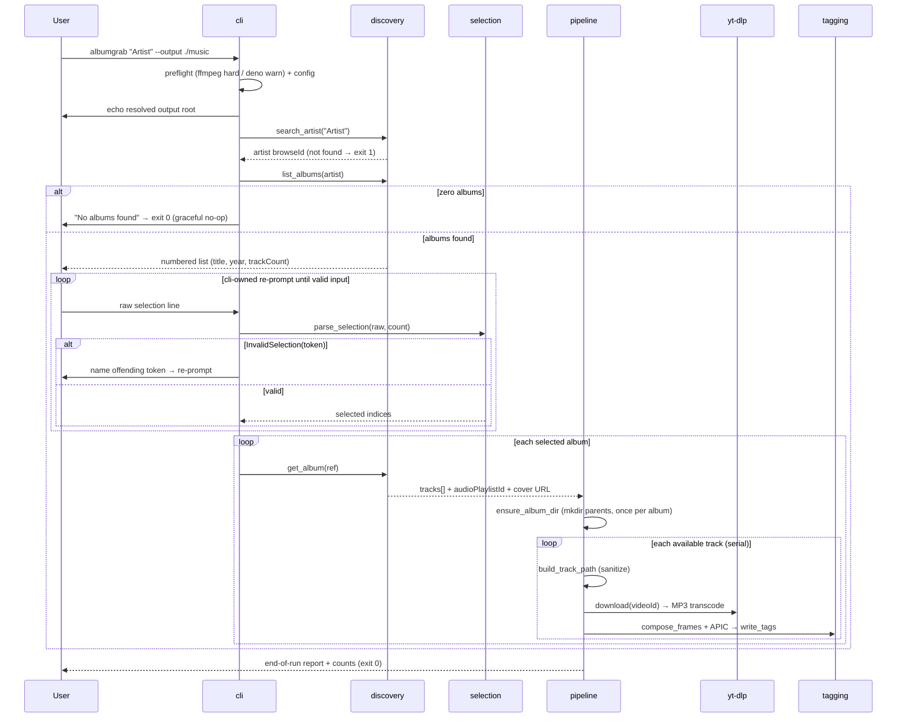

# Design: albumgrab-mvp

Date: 2026-09-15 | Phase: sdd-design | Store: both (this file + engram `sdd/albumgrab-mvp/design`)
Revision: 2 — corrective re-run fixing 6 validator findings: (1) serial-only downloads, concurrency moved to Rejected Alternative; (2) zero-albums graceful-exit coverage; (3) selection re-prompt loop owner; (4) on-demand directory creation owner; (5) resolved-output-root echo at startup; (6) accurate spec-scenario → test mapping. Spec deltas untouched — design conforms to them.

## Technical Approach

Own thin Python CLI (Typer) orchestrating ytmusicapi (discovery), yt-dlp (acquisition), mutagen (tagging). Pure core — selection parsing, path layout/sanitization, tag-frame composition, config validation, report building — with network/filesystem pushed into thin adapters. This split is what makes strict TDD (`uv run pytest`, RED-GREEN-REFACTOR) practical. Implements all six NEW capabilities: `artist-discovery`, `album-selection`, `track-acquisition`, `mp3-tagging`, `library-layout`, `cli-runtime`. Downloads are strictly serial (see Rejected Alternative).

## Architecture Decisions

### Decision: Module layout — src-layout with pure/adapter separation

**Choice**: `src/albumgrab/` as below. **Alternatives**: flat module; framework-y layered app. **Rationale**: src-layout forces explicit imports; purity split gives unit-testable core without mocks.

| Module | Responsibility | Purity |
|---|---|---|
| `cli.py` | Typer app, args, exit codes, resolved-output-root echo at run start, selection re-prompt loop (owns `InvalidSelection` catch), quality notice | thin |
| `pipeline.py` | Run loop: discover→select→download→tag→report; zero-albums check; per-album `ensure_album_dir`; error containment | orchestration via protocols |
| `config.py` | `Config` dataclass, TOML load + validation, defaults | pure (read is its only I/O) |
| `discovery.py` | `Catalog` protocol + `YTMusicCatalog` adapter | adapter |
| `selection.py` | `parse_selection(raw, count)` | PURE |
| `layout.py` | `sanitize_segment`, `build_track_path`, `ensure_album_dir` | pure (`ensure_album_dir` is its only I/O) |
| `downloader.py` | `Downloader` protocol + `YtDlpDownloader` | adapter (subprocess-swappable) |
| `tagging.py` | `compose_frames` (pure) + `write_tags` (I/O) | split |
| `preflight.py` | `shutil.which`: ffmpeg/ffprobe hard, deno warn | thin |
| `report.py` | `TrackOutcome`, `RunReport`, render | pure |

### Decision: The 8 proposal assumptions — final calls

| # | Assumption | Call | Rationale |
|---|---|---|---|
| 1 | Numbered multi-select, no Textual | Confirm | pure `parse_selection`; TDD-trivial; zero TUI dep |
| 2 | `{artist}/{album}/{NN - track}.mp3` | Confirm | mandated by `library-layout` spec |
| 3 | Skip + report unavailable tracks | Confirm | mandated; `isAvailable:false`/region locks are certain |
| 4 | Per-track videoIds + `audioPlaylistId` fallback | Confirm | precise tagging + resumable; fallback covers video-only albums |
| 5 | XDG `~/.config/albumgrab/` (honors `XDG_CONFIG_HOME`) | Confirm | mandated by `cli-runtime` spec |
| 6 | Rate limiting config-driven | Confirm | knobs are per-machine; no code constants |
| 7 | yt-dlp in-process behind `Downloader` protocol | Confirm | `progress_hooks` + `extractor_args`; subprocess swap = 1 class, no CLI/tagging changes |
| 8 | Raw ID3 frames only (TIT2/TPE1/TALB/TRCK/TDRC/TCON/TPE2 + APIC) | Confirm | EasyID3 cannot reach APIC; one code path |

### Decision: Default `--output`

**Choice**: `./albumgrab-music` (cwd-relative). Precedence: CLI `--output` > `[output] root` in config > default. **Alternatives**: XDG data dir (hides user-facing artifacts); bare cwd (scatters files). **Rationale**: downloads are the product — visible and predictable beats tidy; rollback = delete one directory.

### Decision: Sanitization variant

**Choice**: invalid chars + control chars → `_`; reserved device names (case-insensitive, `CON` → `CON_`) suffixed `_`; truncate segments > 120 chars; strip trailing dots/spaces; empty result → `untitled`; `NN` prefix and `.mp3` extension never altered. **Alternatives**: hex-encoding, strip-not-replace. **Rationale**: `_` keeps names readable; tests pin the INVARIANT (segment non-empty, no invalid/control chars, non-reserved, ≤120, no trailing dot/space), not exact literals — any safe variant passes.

### Decision: Error taxonomy

| Class | Examples | Behavior | Exit |
|---|---|---|---|
| Fatal/preflight | ffmpeg/ffprobe missing, unknown artist, invalid config key/value | clear message, abort before downloads | non-zero |
| Graceful no-op | artist resolves but has zero albums | `pipeline` detects empty `list_albums` result, prints `No albums found for '<artist>'`, stops before the selection prompt | 0 |
| Per-track | download/transcode failure, unavailable/region-locked | record `TrackOutcome(track, stage, reason)`, continue track/album/run | report |
| API/network | HTTP 429, timeouts | exponential backoff (base `backoff_base`, ×`retries`), then record + continue; ytmusicapi browse error aborts that album only | report |
| Degraded | cover fetch fails | warn, write text frames only | report |

Report: one row per skipped/failed track `{artist, album, "NN title", stage, reason}` + counts (downloaded/skipped/failed). Exit-code contract: exit 0 whenever the run completes — including the zero-albums graceful no-op (spec: "reports that no albums were found and exits gracefully", deliberately distinct from unknown artist's mandated non-zero); non-zero only for the fatal/preflight class.

### Decision: Config schema (`config.toml`, XDG)

```toml
[download]
sleep_interval = 1.0      # s between tracks (also mapped to yt-dlp opt)
max_sleep_interval = 3.0  # jitter upper bound
retries = 3
backoff_base = 2.0        # 429 backoff: base * 2**attempt
[youtube]
player_client = ["android", "ios", "web_music"]  # ordered cycling
cookies_file = ""         # optional path to cookies.txt
[binaries]
ffmpeg = ""               # optional explicit path → yt-dlp ffmpeg_location
[output]
root = ""                 # default output root when --output absent
```

Defaults apply when file is missing. Schema is closed — exactly the keys above; the rate-limit knobs mirror the `cli-runtime` MUST-list exhaustively (sleep interval, ordered player-client list, 429 backoff-and-retry) plus its MAY (optional cookies). Unknown keys and invalid values fail naming the offending key (typo protection), exit non-zero. Deno: PATH-only, no config key. **No `concurrency` key exists** — see Rejected Alternative.

### Decision: Progress display

**Choice**: plain `typer.echo` lines (`[3/10] Track Title`) + plain-text report. **Alternatives**: rich `Live` bars, Textual (rejected in proposal). **Rationale**: spec requires one line of per-track progress; plain output is assertable in `CliRunner` tests and CI-stable.

### Rejected Alternative: Threaded/concurrent downloads

**Rejected**: a `concurrency` config key / `--concurrency` flag driving a worker-thread pool in the download stage. **Why rejected**: 429/anti-bot risk scales with the parallel request rate against YouTube; `sleep_interval` pacing plus ordered `player_client` cycling are the primary defense and presuppose a serial request stream — parallel downloads multiply 429/throttle blast radius and make pacing non-deterministic. No spec requires it: the `cli-runtime` config MUST-list is exhaustive and contains no concurrency knob, so the feature is untraceable to any capability. **Revisit path**: only via a future spec change that adds a concurrency requirement to `track-acquisition`; then a bounded worker pool behind the `Downloader` protocol (cap ≤ 3) can be designed without touching CLI/tagging layers.

## Data Flow

```
cli → preflight → config load/validate → echo resolved output root
    → Catalog.search_artist (no match → "artist not found", exit 1)
    → Catalog.list_albums
        → empty → pipeline: "No albums found for '<artist>'" → exit 0 (graceful no-op)
    → selection loop (cli.py owns): prompt → parse_selection(raw, count)
        → InvalidSelection(token) → print offending token → re-prompt (loops only until valid input)
    → for each selected album: Catalog.get_album
        → ensure_album_dir(album_dir)  # mkdir(parents=True, exist_ok=True); once per album, before first track write
        → for each available track (strictly serial): build_track_path → Downloader.download
          → compose_frames(+cover fetched once/album) → write_tags → TrackOutcome
    → RunReport.render (exit 0)
```

Cover art: album thumbnail downloaded once per album (stdlib `urllib`, no new dep), bytes reused for every APIC frame of that album. Downloader opts: `format: bestaudio/best`, per-track `outtmpl`, `FFmpegExtractAudio` (mp3) — no `EmbedThumbnail`; tagging is ours via mutagen.

## Sequence Diagrams

### Happy path



### Partial-failure / skip path

```mermaid
sequenceDiagram
    participant P as pipeline
    participant Y as yt-dlp
    participant R as report
    loop each track (serial)
        alt isAvailable == false / region-locked
            P->>R: skip(track, reason)
        else yt-dlp fails (e.g. 429)
            P->>Y: backoff retry × retries
            Y-->>P: still failing
            P->>R: fail(track, reason) → next track
        else cover fetch fails
            P->>P: warn, write text frames only
        else success
            P->>R: ok(track)
        end
    end
    P->>P: render report (album, NN title, stage, reason) + counts; exit 0
```

## File Changes

| File | Action | Description |
|---|---|---|
| `pyproject.toml` | Create | Package, deps (`ytmusicapi>=1.12`, `yt-dlp>=2026.7`, `mutagen`, `typer`; dev: pytest, ruff, pytest-cov), `albumgrab` script, ruff/pytest config |
| `src/albumgrab/*.py` | Create | 10 modules per layout table |
| `tests/unit/*`, `tests/smoke/*` | Create | Strict-TDD suite (see strategy) |
| `README.md` | Create | Usage, prerequisites, ~128 kbps ceiling notice |
| `.gitignore` | Create | `.venv/`, `__pycache__/`, output dirs |

## Interfaces / Contracts

```python
@dataclass(frozen=True)
class TrackRef: video_id: str | None; title: str; track_number: int; is_available: bool

class Catalog(Protocol):
    def search_artist(self, name: str) -> Artist | None: ...
    def list_albums(self, artist: Artist) -> list[AlbumRef]: ...
    def get_album(self, ref: AlbumRef) -> Album: ...          # tracks[] + audio_playlist_id + cover_url

class Downloader(Protocol):
    def download(self, video_id: str, audio_playlist_id: str | None, dest: Path) -> Path: ...

def parse_selection(raw: str, count: int) -> list[int]      # raises InvalidSelection(token); cli.py owns the catch/re-prompt loop
def sanitize_segment(name: str) -> str                      # invariant-pinned, pure
def build_track_path(root: Path, artist: str, album: str, n: int, title: str) -> Path
def ensure_album_dir(album_dir: Path) -> Path               # mkdir(parents=True, exist_ok=True); pipeline calls once per album before first write
def compose_frames(album: AlbumMeta, track: TrackMeta) -> list  # pure; TRCK "4/12", TDRC year
def write_tags(path: Path, frames: list, cover_jpeg: bytes | None) -> None
```

Playlist fallback lives inside `YtDlpDownloader`: when `video_id` is None but `audio_playlist_id` exists, the album is fetched as an audio playlist and matched by position/title for tagging.

## Testing Strategy (spec scenarios → tests)

All 35 spec scenarios across the 6 capabilities map to a row below (artist-discovery 4, album-selection 7, track-acquisition 6, mp3-tagging 4, library-layout 5, cli-runtime 9).

| Layer | Covers (capability → scenarios) | Approach |
|---|---|---|
| Unit (pure) | album-selection — all 7: single number; inclusive range; mixed list + dedup; "all" case-insensitive; out-of-range rejected; garbage token rejected; inverted range rejected (`parse_selection`) · library-layout — layout applied (`03 - Song.mp3`), invalid chars, reserved name, overlong truncation (invariant asserts) · cli-runtime — defaults without config file, invalid config rejected (offending key named), `--output` precedence · mp3-tagging — `compose_frames` full frame set, TRCK "4/12", TDRC year · artist-discovery — zero-albums decision → message + exit 0 | pytest, no mocks |
| Unit (tmp files) | mp3-tagging — all 4: tags written (read-back), track position 4 of 12, cover embedded (APIC `PictureType.COVER_FRONT`), missing-cover degrade (text frames + warning) · library-layout — directories created on demand (`ensure_album_dir` before first write) | `tmp_path` |
| Unit (fakes) | track-acquisition — all 6: downloaded+transcoded (one MP3 at layout path), source caps quality (assert mp3 extract opts; no lossless claim), playlist fallback, region-locked skip + run completes, end-of-run skip report, download error contained · cli-runtime — **429 backoff** (fake Downloader raises 429 → backoff `backoff_base`×attempt up to `retries`, then record + continue), rate-limit knobs honored (sleep pacing + ordered `player_client` in opts), missing-ffmpeg hard-fail, missing-deno warn, progress shown ("[3/10] title"), notice displayed, resolved-root echoed, invocation runs pipeline · artist-discovery — unknown artist non-zero before downloads; known artist resolves + albums listed with metadata; artist without albums exits 0 · CliRunner end-to-end with `FakeCatalog`/`FakeDownloader` | protocol fakes |
| Smoke | cli-runtime invocation against real network: ytmusicapi live chain (search→artist→albums→get_album) — 5-minute manual check at apply; CI runs it mocked; live-network tests marked `live`, skipped by default | `pytest.ini` markers |

Coverage ≥ 80% is the `sdd-verify` gate.

## Threat Matrix

| Boundary | Applicability |
|---|---|
| Documentation-like paths | N/A — no executable docs shipped |
| Git repository selection | N/A — no git automation in the tool |
| Commit / Push state | N/A — no VCS operations |
| PR commands | N/A — no PR automation |

Subprocess note: albumgrab never composes shell strings; yt-dlp runs in-process and consumes ffmpeg/Deno itself. If `YtDlpDownloader` is swapped for a subprocess adapter, args MUST be list-form without `shell=True`; the sanitization invariant (no shell-hostile chars in path segments) is the standing guard. No tasks manufactured for N/A rows; the sanitizer invariant tests (library-layout spec) carry this boundary into RED tests.

## Migration / Rollout

No migration (greenfield). Rollback: delete output dir + XDG config; dependency floor pins allow lockfile reverts; `Downloader` protocol isolates any yt-dlp API-churn retreat to one class.

## Open Questions

None blocking. The subprocess swap remains an apply-time contingency, not an open question.
